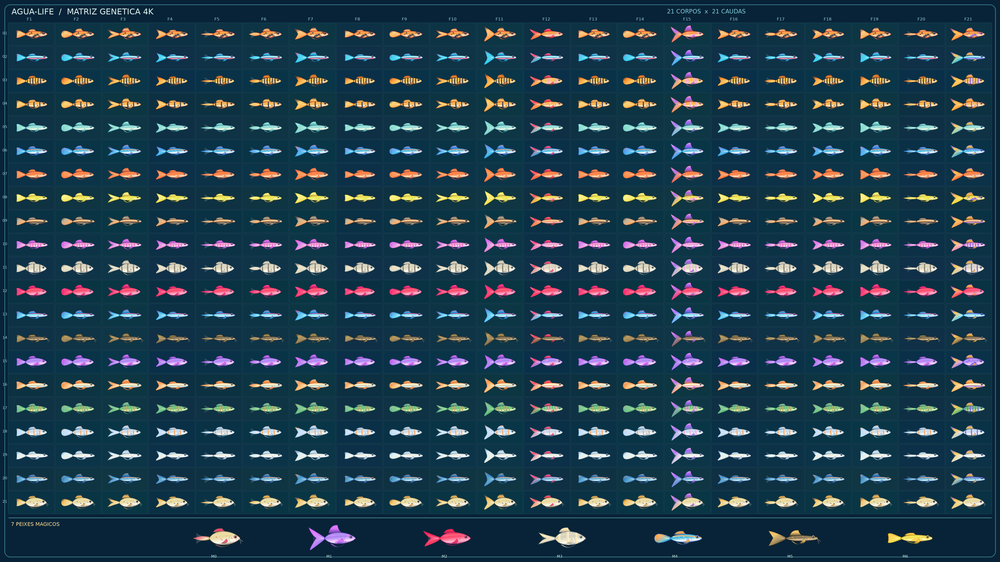

# agua-Life — Matriz 4K com 441 peixes HD (Lua + LÖVE)

Jogo de aquário genético em Lua/LÖVE 11.x com reprodução, DNA, doenças, alimentação, comércio, pesquisas, dois aquários e salvamentos.



## Nova arte HD — células sem invasão entre peixes

A matriz foi **redesenhada com geometria vetorial e detalhes próprios**. A antiga imagem de 1672×941 continha peixes próximos demais e acabava puxando partes de outras células durante o recorte. Em vez de ampliar aqueles pixels, o gerador de alta definição cria cada peixe **sozinho em uma prancheta transparente**, verifica as margens e só então monta a matriz.

- **441 peixes C1–C21 × F1–F21**, mais **sete especiais M0–M6**.
- **448 PNGs individuais RGBA de 512×256**, todos na mesma prancheta e com **margens transparentes mínimas de 13 pixels**.
- **Catálogo 4K 4096×2304**, gerado a partir dos PNGs, não usado como fonte para recortá-los.
- **Atlas 4K transparente separado**, destinado apenas a miniaturas da coleção para renderizar 441 células em uma única textura.
- A arte contém escamas, sombreamento, olho, brânquias, diferenças de forma, marcações e **21 desenhos de barbatanas**. As sete combinações especiais possuem versões destacadas.
- Os genes de corpo/cauda escolhem o PNG correspondente. Genes de paleta/estampa fazem alterações adicionais via shader GPU, sem alterar a transparência.
- O aquário, o zoom lateral, a reprodução, o laboratório e o ateliê utilizam os **PNGs HD individuais**. O catálogo usa o atlas 4K com miniaturas.

A versão antiga permanece em `assets/fish/matrix/` como **fallback e referência**, sem ser utilizada como arte principal quando os sprites HD estão presentes. O `Fish-Tycoon-Lua` original continua intacto.

### Movimento

`art/hd_matrix.lua` carrega os sprites HD sob demanda, mantém cache limitado de 48 imagens e usa uma malha UV para mover suavemente cauda, dorsal e ventral **sem cortar o corpo em retângulos que deixam buracos**. O movimento fica mais lento se o peixe adoecer. O ateliê permite ver as regiões anatômicas do próprio sprite.

Os desenhos continuam sendo imagens bidimensionais: a malha anima o contorno mas **não equivale a animações quadro a quadro ou um rig completo de todas as nadadeiras**. Também não aumenta magicamente a definição da imagem antiga: esta nova arte foi recriada como ilustração vetorial estilizada.

## Jogar no Windows

1. Instale [LÖVE 11.x](https://love2d.org).
2. Acesse [GitHub Actions: Lua tests](https://github.com/SrTristeSad/agua-Life/actions/workflows/lua-tests.yml), abra a execução verde mais recente e baixe **agua-Life-Windows-HD-4K**.
3. Extraia o ZIP, abra a pasta `agua-Life` e execute `INICIAR_WINDOWS.bat`.
4. Entre em **Nova partida** ou **Continuar**.

A versão compactada inclui todos os 448 PNGs de alta definição. Para executar o código-fonte baixado do repositório, use `love .` dentro da pasta do projeto.

### Comandos

| Entrada | Ação |
|---|---|
| Mouse | Selecionar peixes e usar botões |
| 1 / 2 | Aquário / viveiro |
| 3 / 4 | Loja / laboratório DNA |
| 5 / 6 | Catálogo 21×21 / ateliê |
| B | Cruzar dois peixes adultos, escolhendo o segundo no aquário |
| F / H | Alimentar / tratar |
| F8 / F9 | Exame DNA / necropsia |
| J | Exibir pontos da animação |
| P / S | Pausar / salvar |
| Escape | Voltar ao menu |

Na coleção, clique em qualquer célula C×F para ver o peixe HD ampliado à direita. Na reprodução, os genes dos dois pais determinam o descendente. O DNA herdado continua salvo em JSON, sem mudança de formato nesta atualização.

## Código e geração

- `scripts/build_hd_matrix.py`: desenho vetorial procedural **reproduzível** e produção dos 448 PNGs, matriz 4K, atlas e manifesto.
- `assets/fish/hd/sprites/C01_F01.png` a `C21_F21.png`: sprites normais, todos 512×256.
- `assets/fish/hd/sprites/M0.png` a `M6.png`: sete especiais.
- `assets/fish/hd/catalog_4k.png`: catálogo completo 4096×2304 para inspeção.
- `assets/fish/hd/atlas_4k_rgba.png`: atlas transparente 4K apenas de miniaturas.
- `assets/fish/hd/manifest.json`: tamanho da matriz, margens, posições e pares mágicos.
- `art/hd_matrix.lua`: runtime HD com sprites completos, cache e animação.
- `art/matrix.lua`: compatibilidade com a antiga imagem fornecida.
- `art/dna_visual.lua`: expressão visual do DNA por shader.
- `game/play.lua`, `game/storage.lua`: regras, economia, ciclos e saves.

Para reconstruir todos os arquivos:

```bash
python -m pip install pillow cairosvg
python scripts/build_hd_matrix.py --out assets/fish/hd --workers 4
```

O workflow [Build original 4K fish matrix](https://github.com/SrTristeSad/agua-Life/actions/workflows/build-hd-matrix.yml) executa a geração e versiona os PNGs. O workflow [Lua tests](https://github.com/SrTristeSad/agua-Life/actions/workflows/lua-tests.yml) verifica os 448 arquivos, as margens transparentes, a renderização LÖVE e empacota o jogo.

**Estado:** base jogável em evolução. Ainda são desejáveis melhorias no sistema de animação individual por espécie, equilíbrio de jogo e testes de desempenho em dispositivos reais.
