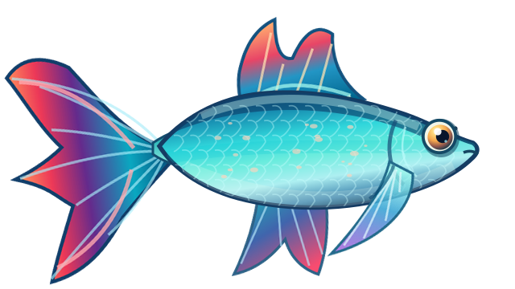

# agua-Life — peixes vivos com arte modular e DNA

Jogo em **Lua + LÖVE 11.x**. O aquário possui 21 formas de corpo, 21 caudas, 12 paletas e 6 padrões decorativos, além de genética e simulação básica de saúde.

## Primeiro peixe original animado: Azul-Rubi

[Ver a animação real em GIF](assets/fish/azul_rubi/swim.gif)

O exemplar **Azul-Rubi** foi criado do zero como ilustração vetorial, exportada para **12 camadas PNG transparentes de 640×360** e SVGs editáveis. Partes independentes do peixe:

- Corpo com escamas e sombras; cauda articulada; dorsal; ventral; peitoral; olhos.
- Seis camadas de estampas, cada uma selecionada pelo gene `pattern`.
- Recoloração por paleta genética em shader, com 12 variações visuais.
- Nado com oscilação do corpo, cauda e nadadeiras, piscada ocasional e amplitude reduzida quando doente.

A matriz genética atual permite **72 visuais** do Azul-Rubi (12 paletas × 6 estampas). Mudanças de corpo/cauda ainda recorrem ao renderizador procedural do aquário: **somente um modelo recebeu camadas PNG nesta etapa**.

### Mostrar as partes no jogo

1. Instale o LÖVE 11.x e execute `love .` na raiz.
2. Selecione o primeiro peixe, o **Azul-Rubi**.
3. Pressione **3** para abrir o *Ateliê* e ver o peixe montado e suas partes separadas.
4. Pressione **J** para ver os pontos de articulação.
5. Use **C** ou **X** no laboratório para alterar genes de cor/estampa e observar a mudança do peixe.

### Outros comandos

- **1** aquário, **2** galeria, **3** ateliê;
- Setas: corpo e cauda; **C**: paleta; **X**: estampa;
- **N**: cruzar peixe selecionado com o seguinte; **F**: alimentar; **H**: tratar;
- **F8**: ficha genética; **F9**: necropsia da última morte;
- **Espaço**: pausar; **R**: reiniciar; **F12**: captura de tela.

## Projeto e testes

- `art/rigged_fish.lua`: composição das camadas em LÖVE e hierarquia de pivôs.
- `scripts/generate_azul_rubi.py`: fonte que **gera as artes originais SVG e PNG**, GIF e `rig.json`.
- `assets/fish/azul_rubi/`: camadas individuais, transparência e amostras.
- `art/fish.lua`: renderização procedural das outras combinações de corpo e cauda.
- `genetics/`: herança, doenças, predisposições e relatórios.
- `tests/rigged_fish.lua`: valida modelos, genes e nado.
- `docs/ANIMACAO_MODULAR.md`: especificação de posições, formatos e extensão.

Rodar testes de lógica: `lua tests/rigged_fish.lua && lua tests/genetics.lua`. A rotina GitHub Actions também confere PNGs RGBA e executa um smoke test gráfico via LÖVE em ambiente virtualizado.

Para regenerar as ilustrações, use `python -m pip install cairosvg pillow` e `python scripts/generate_azul_rubi.py`. São dependências apenas do **exportador de artes**; não do jogo.

## Estado do projeto

O `Fish-Tycoon-Lua` **não foi modificado**. Sua reconstrução 1:1 está preservada em `fish-tycoon-reference/`, separada do novo cliente visual de `agua-Life`. Ainda não foi concluída a união integral de toda a jogabilidade da reconstrução com a interface nova.

Os desenhos Azul-Rubi são originais, não são uma edição dos sprites comerciais de Fish Tycoon.
