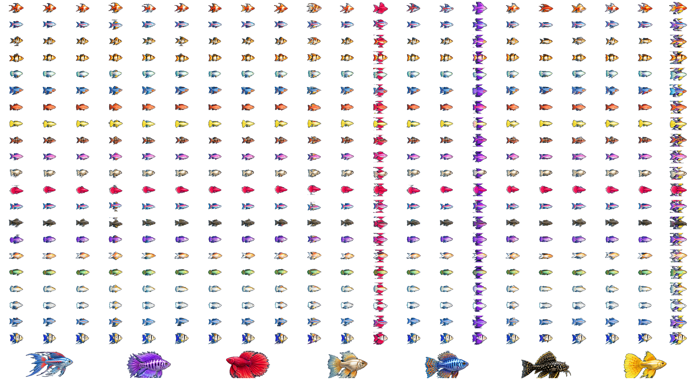

# agua-Life — matriz 21×21 jogável (Lua + LÖVE)

Jogo original de aquário genético em **Lua + LÖVE 11.x**, com reprodução, doenças, pesquisas, alimentação, comércio, aquários e salvamentos.

## A matriz que aparece no jogo

Agora **o cliente usa os próprios peixes da imagem escolhida**, não a reconstrução procedural anterior: a imagem foi transformada em um atlas RGBA de **441 células (21 corpos × 21 barbatanas)**, mais os **sete peixes especiais M0–M6**. O catálogo, os peixes nadando, o exame de DNA e as prévias utilizam o atlas.



Os genes de **corpo (C)** e **barbatanas (F)** escolhem qual sprite C×F aparece. Na reprodução, os alelos de ambos os pais contribuem para o aspecto do filhote. Os genes adicionais de **paleta** e **estampa** continuam registrados no DNA, mas por enquanto **não criam novas imagens fora da matriz**: isso requer variações visuais adicionais.

### Como a animação funciona

O arquivo `art/matrix.lua` usa Quads do LÖVE para **recortar a cauda, a nadadeira dorsal, a ventral e a área central do peixe** a partir do sprite transparente. O recorte acontece em memória, sem gerar centenas de PNGs pequenos em disco. Cauda e nadadeiras giram em pivôs próprios; peixes doentes se movem de modo mais lento.

A imagem original tem resolução **1672×941**, com peixes pequenos; ampliar sprites não inventa detalhe. Algumas barbatanas invadem a célula vizinha na imagem achatada, então há imperfeições pontuais nos recortes. O sistema não finge ter uma malha 3D ou animação desenhada quadro a quadro.

A versão anterior de desenho procedural continua em `art/fish.lua` como fallback para instalações sem o atlas. O cliente normal prioriza sempre `art/matrix.lua`.

## Jogar no Windows

1. Instale o [LÖVE 11.x](https://love2d.org).
2. Abra a [última execução verde do GitHub Actions](https://github.com/SrTristeSad/agua-Life/actions/workflows/lua-tests.yml), baixe o artefato `agua-Life-playable` e extraia o ZIP.
3. Dê dois cliques em `agua-Life-playable.love` (ou arraste o arquivo para `love.exe`).
4. Escolha **Nova partida** ou **Continuar**.

Alternativa: baixe o repositório, entre na pasta com `main.lua` e execute `INICIAR_WINDOWS.bat`.

### Principais comandos

| Controle | Ação |
|---|---|
| Mouse | Selecionar peixes e botões |
| 1 / 2 | Aquário principal / viveiro |
| 3 / 4 | Loja / laboratório de DNA |
| 5 / 6 | Catálogo 21×21 / ateliê de animação |
| B | Escolher parceiro de cruzamento |
| F / H | Alimentar / tratar doença |
| F8 / F9 | Examinar DNA / necropsia |
| J | Mostrar articulações no ateliê |
| P / S | Pausar / salvar |
| Escape | Voltar ao menu |

A partida começa com quatro peixes, alimento, remédios e moedas. Cruzamentos incubam em quatro ciclos; a saúde evolui a cada seis segundos de jogo. Adultos podem ser vendidos, o segundo aquário pode ser desbloqueado e os dados são salvos em JSON com backup.

## Fonte da arte e regeneração

Os seguintes arquivos estão versionados:

- `assets/fish/matrix/atlas_441.png`: **atlas transparente usado no jogo**, com imagens reais das 441 combinações e sete especiais.
- `assets/fish/matrix/atlas_441.json`: tamanho das células e posições.
- `assets/fish/matrix/source_matrix.png.part01` e `source_matrix.png.part02`: os **bytes exatos da imagem recebida**, separados em dois fragmentos apenas para transporte. O extrator os junta automaticamente.
- `scripts/extract_matrix.py`: gerador determinístico dos recortes (Pillow, NumPy e OpenCV).

Para refazer o atlas a partir da fonte no próprio repositório:

```bash
python -m pip install pillow numpy opencv-python-headless
python scripts/extract_matrix.py assets/fish/matrix/source_matrix.png assets/fish/matrix/atlas_441.png
```

A operação mantém o mesmo atlas quando a fonte e a versão do exportador são iguais.

## Arquitetura e testes

- `main.lua`: menu, telas e controles.
- `game/play.lua`: economia, reprodução e ciclos biológicos.
- `game/storage.lua`: saves e validação.
- `genetics/dna.lua`, `genetics/health.lua`: hereditariedade e doenças.
- `art/matrix.lua`: seleção de sprites por DNA, recortes Quads e animação.
- `art/fish.lua`: renderizador procedural de contingência.
- `fish-tycoon-reference/`: referência isolada para pesquisa, não incluída no pacote distribuído.

Testes Lua verificam genética e índices da matriz; o GitHub Actions testa também a **renderização LÖVE** da animação e do catálogo completo.

**Estado:** protótipo jogável, com melhorias pendentes de arte, colisões, camadas anatômicas mais precisas e testes em dispositivos reais. O repositório `Fish-Tycoon-Lua` original não foi modificado.
